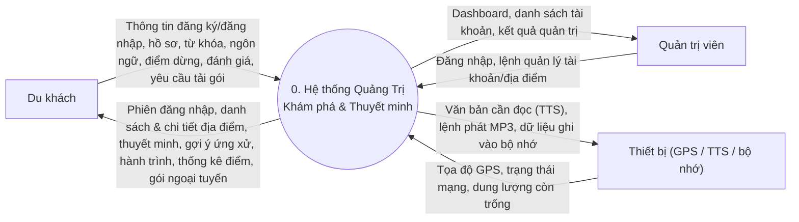
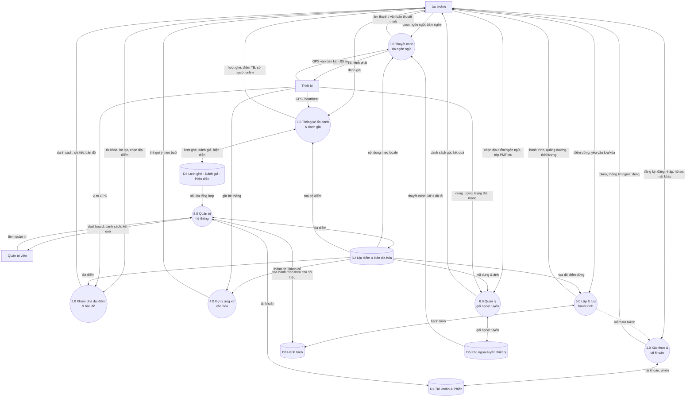
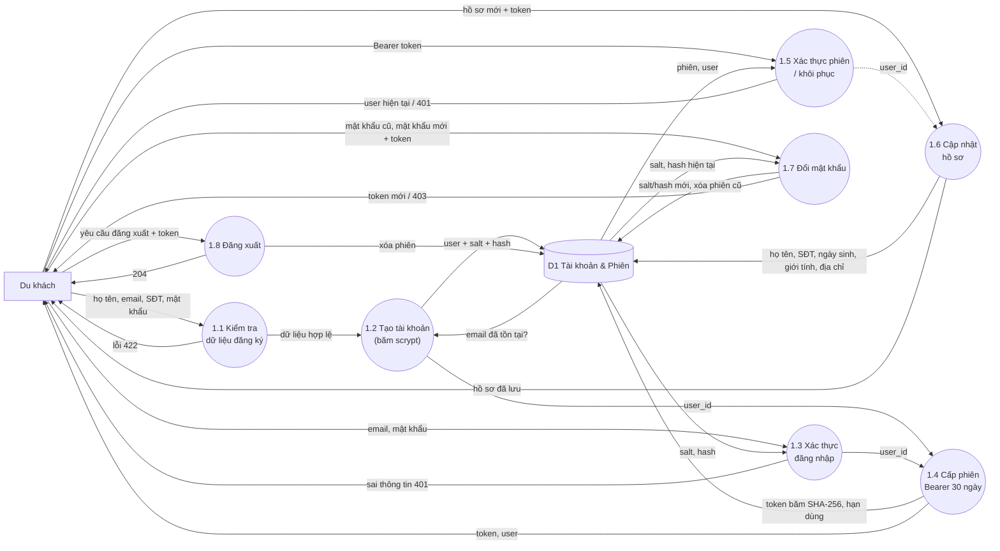
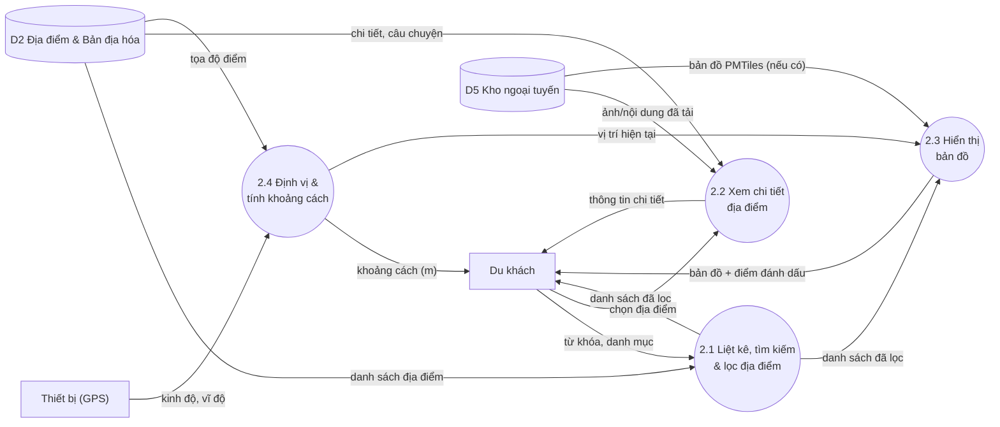
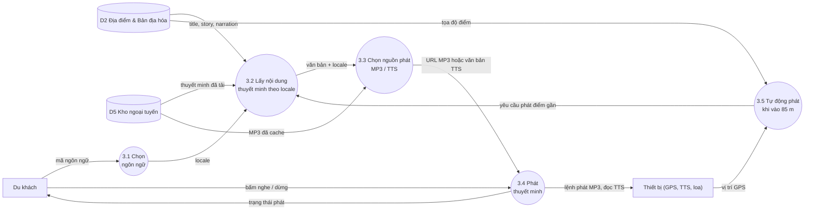
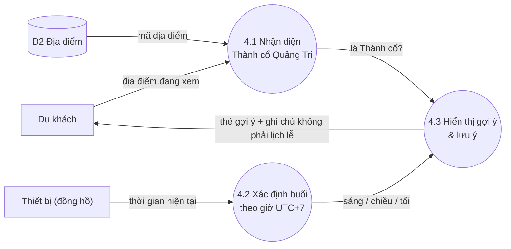
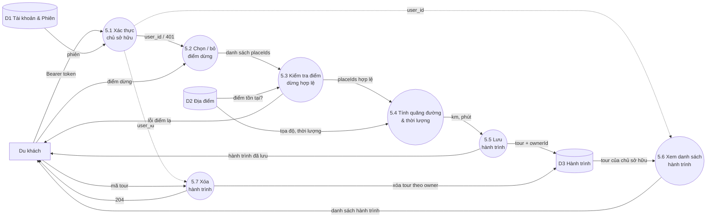
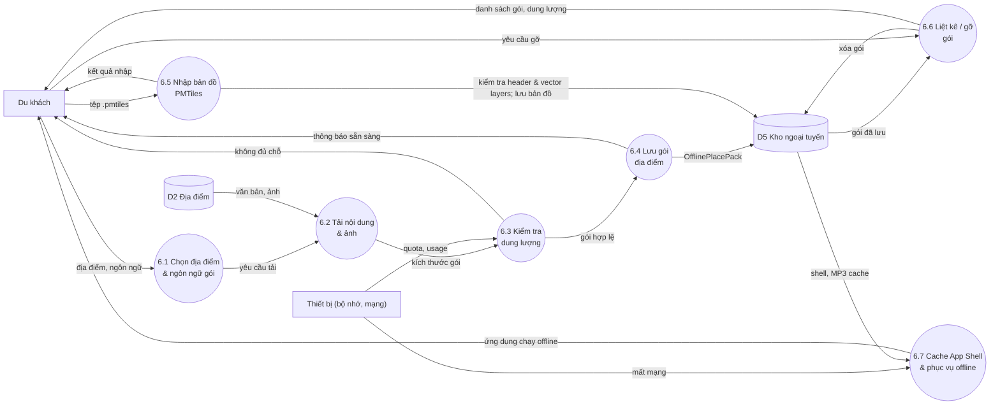
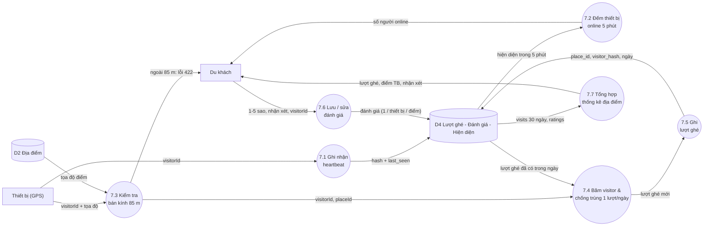
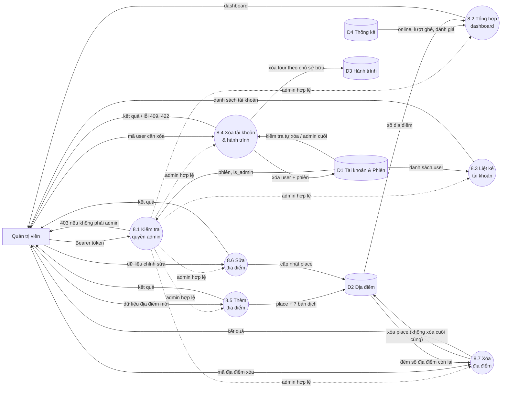

# DFD hệ thống “Khám phá & Thuyết minh du lịch Quảng Trị – Quảng Bình”

Nguồn: [PRD_DoAn_QuangTri.docx](file:///c:/Users/DELL/Desktop/CNPM_DeTai1/docs/PRD_DoAn_QuangTri.docx), đối chiếu với [api.py](file:///c:/Users/DELL/Desktop/CNPM_DeTai1/server/api_gateway/api.py).

**Ký hiệu:** hình chữ nhật = tác nhân ngoài · hình bo tròn = tiến trình · hình trụ = kho dữ liệu · mũi tên = luồng dữ liệu.

## 0. Tác nhân ngoài & kho dữ liệu

| Mã | Tên | Ghi chú |
|---|---|---|
| **DU** | Du khách (nội địa, quốc tế, ngoại tuyến) | Dùng Web PWA / Mobile |
| **QT** | Quản trị viên (`is_admin = 1`) | Dùng cổng `/admin` |
| **TB** | Thiết bị (GPS, TTS/Speech, bộ nhớ) | Cảm biến & dịch vụ của thiết bị |
| **D1** | Tài khoản & Phiên | `accounts.sqlite` (users, auth_sessions) |
| **D2** | Địa điểm & Bản địa hóa | `poi-service.sqlite` (places, 7 locale) |
| **D3** | Hành trình | `tour-service.sqlite` |
| **D4** | Lượt ghé – Đánh giá – Hiện diện | `analytics-service.sqlite` |
| **D5** | Kho ngoại tuyến trên thiết bị | IndexedDB / AsyncStorage (gói địa điểm, MP3, PMTiles, tour cache) |

---

## 1. DFD mức 0 – Sơ đồ ngữ cảnh

---

## 2. DFD mức 1 – Phân rã hệ thống thành 8 tiến trình

---

## 3. DFD mức 2 – Phân rã từng tiến trình

### 3.1 Tiến trình 1.0 – Xác thực & tài khoản

### 3.2 Tiến trình 2.0 – Khám phá địa điểm & bản đồ

### 3.3 Tiến trình 3.0 – Thuyết minh đa ngôn ngữ

### 3.4 Tiến trình 4.0 – Gợi ý ứng xử văn hóa

### 3.5 Tiến trình 5.0 – Lập & lưu hành trình

### 3.6 Tiến trình 6.0 – Quản lý gói ngoại tuyến

### 3.7 Tiến trình 7.0 – Thống kê ẩn danh & đánh giá

### 3.8 Tiến trình 8.0 – Quản trị hệ thống

---

## 4. Vì sao dừng ở mức 2 (tiến trình nguyên tố)

Mỗi tiến trình mức 2 chỉ thực hiện **một** hành động nghiệp vụ, có đầu vào/đầu ra xác định, tương ứng một hàm hoặc một endpoint (ví dụ `AuthRepository.register`, `PlaceCatalog.list`, `TourPlanner.plan`, `_distance_meters`). Nếu phân rã tiếp sẽ chỉ còn các bước lập trình (truy vấn SQL, băm, so sánh chuỗi), không còn là luồng dữ liệu nghiệp vụ nữa.

### Từ điển tiến trình nguyên tố

| Mã | Tiến trình | Đầu vào | Đầu ra | Kho | Endpoint / thành phần |
|---|---|---|---|---|---|
| 1.1 | Kiểm tra dữ liệu đăng ký | họ tên, email, mật khẩu ≥ 8 ký tự | hợp lệ / 422 | – | `RegisterRequest` |
| 1.2 | Tạo tài khoản | dữ liệu hợp lệ | user | D1 | `POST /auth/register` |
| 1.3 | Xác thực đăng nhập | email, mật khẩu | user_id / 401 | D1 | `POST /auth/login` |
| 1.4 | Cấp phiên 30 ngày | user_id | token | D1 | `_create_session` |
| 1.5 | Xác thực phiên | Bearer token | user / 401 | D1 | `GET /auth/me` |
| 1.6 | Cập nhật hồ sơ | hồ sơ mới | hồ sơ đã lưu | D1 | `PUT /auth/me` |
| 1.7 | Đổi mật khẩu | mật khẩu cũ/mới | token mới / 403 | D1 | `POST /auth/change-password` |
| 1.8 | Đăng xuất | token | 204 | D1 | `POST /auth/logout` |
| 2.1 | Liệt kê, tìm kiếm, lọc | từ khóa, danh mục | danh sách | D2 | `GET /places` |
| 2.2 | Xem chi tiết | mã địa điểm | chi tiết | D2, D5 | `GET /places/{id}` |
| 2.3 | Hiển thị bản đồ | danh sách, PMTiles | bản đồ | D5 | `MapView` |
| 2.4 | Định vị, tính khoảng cách | GPS, tọa độ điểm | mét | D2 | Turf `distance` |
| 3.1 | Chọn ngôn ngữ | mã ngôn ngữ | locale | – | `setLanguage` |
| 3.2 | Lấy nội dung thuyết minh | placeId, locale | văn bản | D2, D5 | `GET /narrations/{id}` |
| 3.3 | Chọn nguồn phát | văn bản, MP3 | MP3 hoặc TTS | D5 | `speech.ts` |
| 3.4 | Phát thuyết minh | lệnh nghe/dừng | âm thanh | – | `AudioPlayer`, Expo Speech |
| 3.5 | Tự động phát khi vào 85 m | GPS, tọa độ | yêu cầu phát | D2 | `ExplorePage` |
| 4.1 | Nhận diện Thành cổ | mã địa điểm | cờ Thành cổ | D2 | `RitualGuidancePanel` |
| 4.2 | Xác định buổi | giờ UTC+7 | sáng/chiều/tối | – | `getVietnamHour` |
| 4.3 | Hiển thị gợi ý | cờ, buổi | thẻ gợi ý | – | `RitualGuidancePanel` |
| 5.1 | Xác thực chủ sở hữu | token | user_id | D1 | `authenticated_user` |
| 5.2 | Chọn / bỏ điểm dừng | thao tác chọn | placeIds | – | `setRoutePlace` |
| 5.3 | Kiểm tra điểm dừng | placeIds | hợp lệ / lỗi | D2 | `TourPlanner` → POI |
| 5.4 | Tính km và phút | tọa độ, thời lượng | km, phút | D2 | `TourPlanner` |
| 5.5 | Lưu hành trình | tour, ownerId | tour đã lưu | D3 | `POST /tours` |
| 5.6 | Xem danh sách | user_id | danh sách tour | D3 | `GET /tours` |
| 5.7 | Xóa hành trình | mã tour, user_id | 204 | D3 | `DELETE /tours/{id}` |
| 6.1 | Chọn địa điểm, ngôn ngữ gói | lựa chọn | yêu cầu tải | – | `SettingsPage` |
| 6.2 | Tải nội dung, ảnh | yêu cầu | blob + văn bản | D2 | `fetch` |
| 6.3 | Kiểm tra dung lượng | size, quota | đủ / không | – | `navigator.storage` |
| 6.4 | Lưu gói | gói hợp lệ | gói đã lưu | D5 | `saveOfflinePlacePack` |
| 6.5 | Nhập PMTiles | tệp .pmtiles | bản đồ offline | D5 | `importMap` |
| 6.6 | Liệt kê, gỡ gói | yêu cầu | danh sách | D5 | `deleteOfflinePlacePack` |
| 6.7 | Cache App Shell | mạng đứt | chạy offline | D5 | Workbox `sw.ts` |
| 7.1 | Ghi nhận heartbeat | visitorId | last_seen | D4 | `POST /analytics/presence` |
| 7.2 | Đếm online 5 phút | hiện diện | số online | D4 | `GET /analytics/presence` |
| 7.3 | Kiểm tra 85 m | tọa độ, điểm | hợp lệ / 422 | D2 | `_distance_meters` |
| 7.4 | Băm visitor, chống trùng | visitorId, placeId | lượt mới | D4 | analytics repository |
| 7.5 | Ghi lượt ghé | lượt mới | bản ghi | D4 | `POST /analytics/visits` |
| 7.6 | Lưu / sửa đánh giá | sao, nhận xét | tổng hợp | D4 | `POST /analytics/ratings` |
| 7.7 | Tổng hợp thống kê | placeId | lượt, điểm TB | D4 | `GET /places/{id}/analytics`, `/ratings` |
| 8.1 | Kiểm tra quyền admin | token | admin / 403 | D1 | `admin_user` |
| 8.2 | Tổng hợp dashboard | – | số liệu | D2, D4 | `GET /admin/overview` |
| 8.3 | Liệt kê tài khoản | – | danh sách | D1 | `GET /admin/users` |
| 8.4 | Xóa tài khoản + tour | user_id | kết quả | D1, D3 | `DELETE /admin/users/{id}` |
| 8.5 | Thêm địa điểm | place | kết quả | D2 | `POST /admin/places` |
| 8.6 | Sửa địa điểm | place | kết quả | D2 | `PUT /admin/places/{id}` |
| 8.7 | Xóa địa điểm | placeId | kết quả | D2 | `DELETE /admin/places/{id}` |

Tổng cộng **8 tiến trình mức 1** và **52 tiến trình nguyên tố mức 2**.

---

## 5. Kiểm tra cân bằng giữa các mức

| Tiến trình mức 1 | Luồng vào/ra ở mức 1 | Đã xuất hiện đủ ở mức 2 |
|---|---|---|
| 1.0 | đăng ký, đăng nhập, hồ sơ, mật khẩu ↔ token, user; D1 | ✔ 1.1 → 1.8 |
| 2.0 | từ khóa, chọn địa điểm, GPS, D2 ↔ danh sách, chi tiết, bản đồ | ✔ 2.1 → 2.4 |
| 3.0 | ngôn ngữ, bấm nghe, GPS, D2, D5 ↔ âm thanh, văn bản, lệnh TTS | ✔ 3.1 → 3.5 |
| 4.0 | D2, giờ hệ thống ↔ thẻ gợi ý | ✔ 4.1 → 4.3 |
| 5.0 | điểm dừng, D1 (kiểm tra token), D2, D3 ↔ hành trình | ✔ 5.1 → 5.7 |
| 6.0 | lựa chọn gói, PMTiles, D2, quota mạng/bộ nhớ, D5 ↔ danh sách gói | ✔ 6.1 → 6.7 |
| 7.0 | đánh giá, GPS, heartbeat, D2, D4 ↔ thống kê | ✔ 7.1 → 7.7 |
| 8.0 | lệnh quản trị, D1, D2, D3, D4 ↔ dashboard, kết quả | ✔ 8.1 → 8.7 |

> [!NOTE]
> Ở mức 1, tiến trình 5.0 và 8.0 chỉ vẽ nét đứt/mũi tên tới D1 để biểu diễn việc kiểm tra token. Ở mức 2, việc này được tách thành tiến trình riêng (5.1 và 8.1) nên các luồng vẫn cân bằng.

> [!IMPORTANT]
> Các kho D1–D4 là cơ sở dữ liệu SQLite riêng của từng service ở backend. D5 chỉ nằm trên thiết bị người dùng, không đồng bộ lên server.
